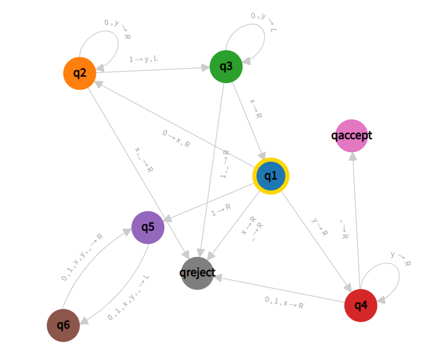

# Máquina de Turing integrada con Pygame

Aplicación de escritorio que reúne la lectura, validación, simulación y salida
del proyecto. Su visualizador permite inspeccionar la cinta, el estado actual
y la próxima transición, con controles inspirados en https://turingmachine.io/.

## Actualización: alerta y parada por ciclo infinito

La interfaz y `main.py --consola` comprueban si se repite exactamente una
configuración: estado, posición del cabezal y contenido de la cinta. No basta
con repetir el nombre del estado. Se ignoran únicamente blancos finales
almacenados de más, porque representan la misma cinta.

Si se prueba un ciclo y han transcurrido al menos 15 movimientos desde la
configuración de referencia del ciclo, la ejecución se detiene. En la interfaz
aparece una alerta con el período detectado. Para `11000111`, `10` o `1`, ocurre
en el paso 16: un movimiento de entrada y 15 dentro del ciclo q5/q6.

Cerrar la alerta no reanuda el ciclo. Puedes guardar la traza, retroceder,
reiniciar o aplicar otra entrada. La tabla de transiciones no se modifica:
la parada corresponde al visualizador, no a aceptación ni rechazo de la máquina.

El observador usa una sola configuración de referencia (algoritmo de Brent),
sin guardar el historial completo y sin intervenir en la memoria de cálculo
del núcleo. Para ciclos largos, la confirmación puede requerir más de 15 pasos;
una vez confirmado, se detiene si el umbral ya se alcanzó. El límite global
sigue existiendo para ejecuciones donde no se ha demostrado un ciclo.

## Instalación y ejecución

Recomendado: Python 3.12 o 3.13. Descomprime el ZIP y abre una terminal dentro
de la carpeta `turing_pygame`:

```bash
python -m pip install -r requirements.txt
python main.py
```

En Windows puedes usar `py` en lugar de `python`. Después de instalar Pygame,
también puedes abrir `INICIAR_WINDOWS.bat`.

Para abrir directamente otra especificación:

```bash
python main.py especificacion_ciclo.txt
```

## Uso del visualizador

1. Selecciona Aceptación, Rechazo, Ciclo o Máquina M2. También puedes escribir
   una ruta y pulsar Cargar, o arrastrar un archivo `.txt` sobre la ventana.
2. Modifica la cadena y pulsa Aplicar entrada o Enter. Un campo vacío representa ε.
   Cambiar el texto por sí solo no altera una ejecución en curso.
3. Pulsa Paso para ejecutar una transición o Ejecutar para avanzar automáticamente.
4. Usa Atrás para reconstruir el paso anterior, o Reiniciar para volver al inicio.
5. Cambia la velocidad con − y +, y el límite mediante el campo LÍMITE.
6. Pulsa Guardar traza para exportar desde la configuración inicial hasta el
   paso que estás visualizando. Los archivos se crean en `exportaciones/`.

| Control | Acción |
|---|---|
| Espacio | Ejecutar / pausar |
| Flecha derecha | Pausar y avanzar una transición |
| Flecha izquierda | Retroceder una transición |
| R | Reiniciar con la cadena aplicada |
| Ctrl+S | Guardar traza hasta el paso actual |
| Ctrl+A dentro de un campo | Seleccionar su contenido para reemplazarlo |
| Enter dentro de un campo | Cargar archivo, aplicar entrada o validar límite |
| Escape | Pausar y salir de la edición del campo |
| Rueda sobre la tabla | Desplazar transiciones |

Los atajos de ejecución funcionan cuando ningún campo está en edición.
Haz clic fuera de los campos para usarlos. El siguiente paso vuelve a centrar
la tabla en la transición activa. La ventana se puede redimensionar hasta
un mínimo de 1120 × 820 píxeles.

El grafo muestra el estado actual y la arista de la próxima transición en
verde. Sus etiquetas completas se consultan en la tabla. Para especificaciones
con más de 16 estados se usa la tabla y se omite el grafo para evitar saturarlo.
Aceptación tiene doble círculo; rechazo se identifica por su nombre y color.

## Ejemplos y resultados

| Archivo | Cadena | Resultado |
|---|---|---|
| especificacion_aceptacion.txt | 0011 | Acepta en 13 pasos |
| especificacion_rechazo.txt | 001 | Rechaza en 8 pasos |
| especificacion_ciclo.txt | 10 | Ciclo confirmado; el visualizador se detiene en el paso 16 |
| especificacion_m2.txt | 0000 | Acepta |

Las tres primeras especificaciones contienen la misma máquina y cambian la
entrada. La máquina acepta `{0ⁿ1ⁿ | n ≥ 1}`, rechaza las otras cadenas que no
empiezan con 1 y cicla con las que empiezan con 1. La cadena vacía se rechaza.

Un límite agotado se informa como **límite alcanzado**, sin declarar que se
ha demostrado un ciclo infinito. Puedes aumentarlo para continuar. El límite
de la interfaz admite valores de 1 a 100000 pasos.

## Ejecutar sin ventana

La consola no requiere Pygame; basta con Python:

```bash
python main.py --consola --limite 100
python main.py especificacion_rechazo.txt --consola --salida rechazo.txt
python main.py especificacion_ciclo.txt --consola --limite 50 --salida ciclo.txt
python validador_mt.py especificacion_aceptacion.txt
```

Para usar directamente los módulos originales integrados:

```bash
python simulador_mt.py especificacion_aceptacion.txt --limite 100
python salida_mt.py especificacion_ciclo.txt salida.txt --limite 50
```

## Formato y compatibilidad con la web

La aplicación carga el formato `.txt` descrito en `FORMATO.md`; no importa
YAML. Cada transición es `estado lee destino escribe L/R`. El blanco se escribe
`_` y se representa como `⊔` en pantalla y en las trazas.

Se incluye `maquina_turingmachine.yaml`, que puedes pegar en turingmachine.io.
Puedes volver a generarlo para cualquier especificación válida:

```bash
python exportar_yaml.py especificacion_aceptacion.txt maquina_turingmachine.yaml
```

Se preservó la cinta semiinfinita del proyecto: en la posición 0, L deja el
cabezal en 0. La web permite cinta hacia ambos lados. Los ejemplos incluidos no
requieren cruzar ese límite; máquinas nuevas que intenten cruzarlo pueden
comportarse de forma diferente en ambos programas.

El núcleo conserva únicamente la cinta como memoria de cálculo. El estado,
el cabezal y el contador son metadatos de simulación. Atrás reconstruye la
máquina ejecutando de nuevo desde el inicio, sin almacenar instantáneas.
La exportación también reproduce la ejecución y escribe en flujo. Retroceder
muchos pasos en máquinas con cintas muy grandes puede tardar.

## Organización

| Archivo | Responsabilidad |
|---|---|
| main.py | Programa principal, interfaz y modo consola |
| lector_mt.py | Lectura y errores de formato con número de línea |
| validador_mt.py | Validación compartida y carga segura |
| simulador_mt.py | Cinta, cabezal, estado y transición paso a paso |
| salida_mt.py | Escritura de configuraciones y límite de pasos |
| visualizador.py | Interfaz gráfica con Pygame |
| detector_ciclos.py | Observación de configuraciones y prueba de ciclos |
| exportar_yaml.py | Exportación al formato de la página |
| tests/ | Pruebas de núcleo, integración e interfaz |

La validación verifica símbolos, estados, determinismo, completitud para estados
no finales y ausencia de salidas de aceptación/rechazo. Una carga inválida no
reemplaza la máquina válida anterior. Los detalles de errores largos pueden
consultarse también ejecutando `validador_mt.py` por consola.

## Pruebas y alcance de la verificación

```bash
python -m unittest discover -s tests -v
```

En el entorno de preparación pasaron 19 pruebas del núcleo y de integración,
incluida la comparación de 4095 cadenas binarias de longitud 0 a 11, ejemplos
M2, rechazo, aceptación, límites, exportación y especificaciones inválidas.
Los archivos Python también pasaron la comprobación de sintaxis.

Las cinco pruebas gráficas se omitieron porque Pygame no estaba disponible
y el entorno no permitió descargarlo. La ventana no pudo verificarse en
ese entorno. Al instalar las dependencias, esas pruebas usan el controlador
SDL dummy para comprobar renderizado, carga, retroceso, alerta de ciclo y controles sin monitor.

Los archivos `configuraciones_*.txt` se regeneraron con esta versión integrada.
